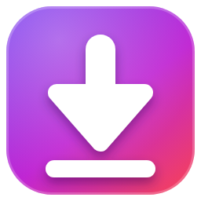

<div align="center">



# Free YouTube Converter Studio

**A modern Windows app to download and convert YouTube videos and playlists.**
Built with WinUI 3 — Mica Alt window, dark/light themes, a clean download queue and plenty of settings.

[](https://github.com/ByteBendr/FreeYouTubeConverterStudio/releases/latest)


</div>

## Features

- **Videos and playlists** — paste a link (or drag one onto the window) and add it to the queue. Playlists can go into their own subfolder, with numbered files.
- **Formats** — MP4, WebM, MP3 and M4A.
- **Quality** — 144p up to 2160p, or *Best* / *Worst*; audio tiers *Best, High, Medium, Low, Worst*. The closest available quality is used if the exact one doesn't exist.
- **Two download engines** — [YoutubeExplode](https://github.com/Tyrrrz/YoutubeExplode) first, with automatic fallback to [yt-dlp](https://github.com/yt-dlp/yt-dlp) when YouTube changes something and the first engine fails.
- **Queue** — live progress, thumbnails, durations, several downloads at once, cancel / retry / remove, optional auto-start.
- **Subtitles** — download as `.srt`, pick a language, optionally embed them in MP4.
- **Built-in YouTube sign-in** — sign in once in an embedded browser so yt-dlp can handle age-restricted videos and "confirm you're not a bot" checks, with no manual cookie export.
- **Dependency check** — one button checks FFmpeg, yt-dlp and Deno and can download/install whatever is missing.
- **Looks native** — Mica Alt backdrop, Fluent navigation, custom title bar, switchable theme and material (Mica Alt / Mica / Acrylic).
- **Lots of settings, saved automatically** — output folder, filename templates (`{title} {author} {id} {quality} {format} {index} {date}`), overwrite behaviour, retries, clipboard auto-paste, open folder when done, always on top, and more.

## Requirements

| | |
|---|---|
| **OS** | 64-bit Windows 10 (1809 or later) or Windows 11. Mica Alt shows on Windows 11; Windows 10 gets a plain background. |
| **Runtime** | [.NET 8 Desktop Runtime](https://dotnet.microsoft.com/download/dotnet/8.0) (x64) |
| **Included** | The Windows App SDK runtime is bundled with the app |
| **Optional** | Microsoft Edge WebView2 Runtime (only for the built-in sign-in window; included with Windows 11) |

The app needs **FFmpeg** (for 720p and above, MP3 conversion and embedded subtitles), **yt-dlp** (fallback engine) and **Deno** (a JavaScript runtime recent yt-dlp versions need for YouTube). You don't have to install them by hand — see [Dependencies](#dependencies).

## Installation

1. Install the [.NET 8 Desktop Runtime](https://dotnet.microsoft.com/download/dotnet/8.0) if you don't have it.
2. Download the `win-x64` zip from the [latest release](https://github.com/ByteBendr/FreeYouTubeConverterStudio/releases/latest).
3. Extract it anywhere and run `FreeYouTubeConverterStudio.exe`. There is no installer.
4. On first launch the app checks for FFmpeg, yt-dlp and Deno and offers to download what is missing.

> **Windows SmartScreen** may warn about an unrecognised app because the executable isn't code-signed. Click **More info → Run anyway** if you trust the source.

## Usage

1. Open **Download**, paste a video or playlist URL, choose a format and quality, then press **Add to queue**.
2. Press **Start queue**. Files are saved to your output folder (default: `Downloads\YouTube`).
3. Use **Open folder** to jump to the finished files.

## Dependencies

**Settings → Dependencies → Check dependencies** looks for each component. If something required is missing, a dialog offers to download and install it — or you can decline and install it yourself, then run the check again.

| Component | Used for | How it's installed |
|---|---|---|
| FFmpeg | merging video + audio, MP3 conversion, embedding subtitles | downloaded from gyan.dev (BtbN builds as fallback) into the app's tools folder |
| yt-dlp | fallback download engine | latest `yt-dlp.exe` from GitHub releases |
| Deno | JavaScript runtime for yt-dlp on YouTube | `winget install DenoLand.Deno` |

Every check writes a small encrypted result file, `hasDepends.bin`, next to the executable. If it is edited, deleted or copied from another PC, the app simply ignores it and checks again. (It detects tampering; it isn't meant as strong security.)

## Troubleshooting

| Problem | Try this |
|---|---|
| *"Video … is not available"* on every video | Keep **Engine** on *Automatic*, press **Download latest** under yt-dlp in Settings (re-run it whenever YouTube changes), and install Deno from the same page. |
| *"Sign in to confirm you're not a bot"* / age-restricted video | Use **Sign in to YouTube** in Settings → Download engine. If Google blocks the embedded browser, pick **Use cookies from browser** instead. |
| 720p+ video, MP3 or subtitle embedding fails | FFmpeg is missing — press **Check dependencies** or **Download** next to the FFmpeg path. |
| Window has no Mica effect | Mica Alt needs Windows 11. |
| App closes or misbehaves | See `app.log` and `crash.log` (see below) and attach them to an issue. |

## Where things are stored

Everything is under `%LocalAppData%\FreeYouTubeConverterStudio\`:

| File / folder | Contents |
|---|---|
| `settings.json` | your settings |
| `tools\` | downloaded `ffmpeg.exe` and `yt-dlp.exe` |
| `youtube-cookies.txt`, `webview\` | your saved YouTube sign-in — **treat it like a password and never share it** |
| `app.log`, `crash.log` | diagnostics |

`hasDepends.bin` lives next to the executable (or in the folder above if that location isn't writable). Use **Settings → YouTube account → Remove** to delete the saved login.

## Building from source

Requirements: Windows 10/11, Visual Studio 2022 17.8+ with the **.NET desktop development** workload (including the Windows App SDK C# templates), or the .NET 8 SDK.

```powershell
git clone https://github.com/ByteBendr/FreeYouTubeConverterStudio.git
cd YOUR-REPO/FreeYouTubeConverterStudio
dotnet run -r win-x64 -p:Platform=x64
```

Publish a framework-dependent x64 build:

```powershell
dotnet publish -c Release -r win-x64 -p:Platform=x64 --self-contained false -o publish\win-x64
```

The app is only built and tested for **x64**. It runs on 64-bit Intel/AMD PCs (ARM PCs may run it through Windows' x64 emulation, but that isn't supported).

> WinUI 3 doesn't support trimming or single-file publishing reliably — leave both off.

## Disclaimer

This tool is provided for downloading content you have the right to save — your own uploads, public-domain or Creative Commons material, or content you have permission to download. Downloading videos may violate YouTube's Terms of Service or copyright law in your country. You are responsible for how you use it. This project is not affiliated with or endorsed by YouTube or Google.

## Credits

- [YoutubeExplode](https://github.com/Tyrrrz/YoutubeExplode) by Tyrrrz
- [yt-dlp](https://github.com/yt-dlp/yt-dlp)
- [FFmpeg](https://ffmpeg.org/)
- [Deno](https://deno.com/)
- [Windows App SDK / WinUI 3](https://learn.microsoft.com/windows/apps/winui/winui3/) and [WebView2](https://developer.microsoft.com/microsoft-edge/webview2/)

## License

Add your license here (for example MIT) and include a `LICENSE` file in the repository.
